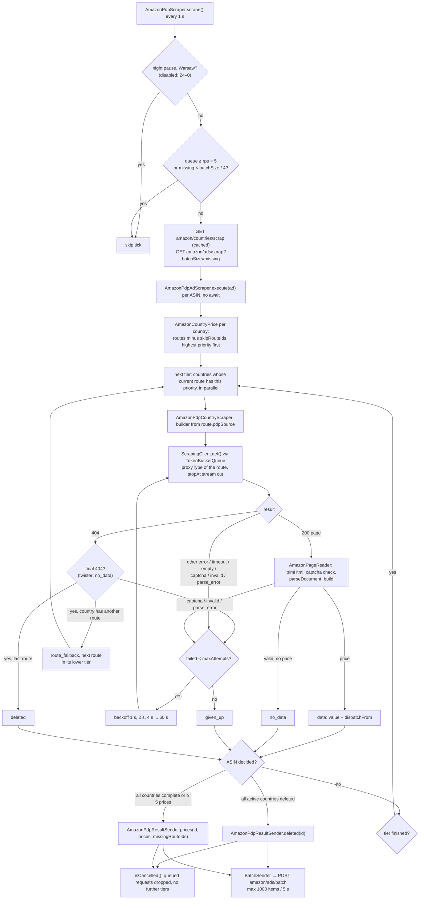

---
paths:
  - "src/marketplaces/amazon/pdp/**"
  - "src/marketplaces/amazon/*.ts"
  - "src/shared/http/**"
  - "src/shared/backend/**"
  - "tests/unit/marketplaces/amazon/pdp/**"
---

# Amazon PDP – flow

Goal: for every ASIN, get the price and the shipper (`dispatchFrom`) in every Amazon country and send them to the backend.

**A PDP logic change (`src/marketplaces/amazon/pdp/`, `AmazonService`, `AmazonCountryService`, shared HTTP/backend) updates this file in the same commit.**

## Diagram

## 1. Process start (`src/index.ts`, `src/marketplaces.ts`)

1. `ArgsService` reads the `-t` flag (none = `pdp`).
2. `ScraperConfigService.load()` fetches `scrapers/<name>/config` (`concurrency`, `rps`, `batchSize`); retries until it succeeds. Then refreshed every minute (cron).
3. `MetricsReporter.start("amazon")`.
4. `ProxyService.loadProxies()` – active datacenter plans of both Webshare keys (other subtypes skipped), each weighted by bandwidth left per ms until its period ends (`/stats/aggregate/`; failed stats = unused), refreshed every hour.
5. `AmazonPdpScraper.execute()`.

## 2. Batch loop (`AmazonPdpScraper`)

1. Calls `scrape()` every second (`POLL_INTERVAL`), the next tick after the previous one finished.
2. Night pause `NIGHT_START`–`NIGHT_END` `Europe/Warsaw` (`AmazonNightSchedule`; disabled: 24–0, was 23–7) → skips; logs `pdp: night pause started` / `ended` on change. ASINs already loaded finish.
3. `batchSize` = most ASINs in flight (`AmazonPdpAdScraper.inFlight`, also those in backoff or waiting for a later tier). Skips the tick while the request queue holds ≥ `rps × 5` requests (5 s of work; `concurrency × 2` when `rps` is 0) or fewer than `batchSize / 4` ASINs are missing to `batchSize`.
4. Gets countries: `AmazonCountryService` (`amazon/countries/scrap`, cached, refreshed every minute). A country has `tld`, `active` and `routes`; a route has `id`, `priority` (unique per country), `proxyType`, `pdpSource` (one source) and `maxAttempts`.
5. Gets the missing ASINs: `amazon/ads/scrap?batchSize=<batchSize - inFlight>` (`id`, `asin`, `skipRouteIds`: routes the backend remembers the ASIN missing in, 30 days).
6. Each ASIN → `AmazonPdpAdScraper.execute(ad, countries)` (no `await`, in parallel).
7. Metric `batch_load`: `ok` / `empty` / `failed`.

## 3. One ASIN (`AmazonPdpAdScraper`)

1. Creates an `AmazonCountryPrice` per country (`complete`, `deleted`, `missingRouteIds`, `retry`, `notFound`, `pastAttempts`) with its routes minus `skipRouteIds`, highest `priority` first; a country without a route left is skipped. Held in `AmazonAdPrices`; none left → `ads{outcome=empty}`, done.
2. Tiers = route priorities of all countries, highest first.
3. Tier by tier: every country not complete whose current route has the tier's priority, in parallel; the next tier only after the previous one finishes.
4. A route ending with a final 404 (added to `missingRouteIds`) while the country has another route → `route_fallback`, the country moves to its next route (new `retry` with that route's `maxAttempts`, `notFound` = 0) and runs in that route's lower tier. Any other outcome (`data`, `no_data` from a page, `given_up`) ends the country, no fallback.
5. After each country, checks whether the ASIN is decided:
   - all **active** countries `deleted` → sends `deleted(id)`, done (`ads{outcome=deleted}`);
   - all countries `complete` **or** ≥ 5 countries with a price (`PRICES_TO_COMPLETE`) → sends prices, done (`prices` / `empty`);
   - otherwise keeps waiting.
6. Once decided, `isCancelled()` = true: queued requests are dropped, further tiers do not start (a lower-priority route may never run).

## 4. One route of a country (`AmazonPdpCountryScraper`)

1. Builder from `route.pdpSource`; unknown = `aod`.
2. Loop until an outcome or cancellation:
   1. `builder.buildUrl()` → request via `AmazonService.get()` with the route's `proxyType`.
   2. Result → outcome (see below). Outcome present → route done; `items` / `item_attempts` counted unless the country falls back (attempts include the routes already left).
   3. No outcome → `failed++`; at `route.maxAttempts` → `given_up`; otherwise backoff 1 s, 2 s, 4 s ... max 60 s, with jitter.
3. Result mapping:
   - 404: `twister` → `no_data`; others → `notFound++`, at 2 (`NOT_FOUND_TO_DELETE`) in an active country, at 1 in an inactive one → `deleted`, before that retry. Both final cases add the route to `missingRouteIds`.
   - other HTTP error / timeout / network → retry; 403 and 429 count toward blocking the direct family for the host (see 7).
   - empty response → retry (`responses{outcome=empty}`).
   - captcha → retry (`captcha`), no block.
   - `isValid === false` → retry (`invalid`).
   - parse exception → retry (`parse_error`).
   - price found → `data`, stores `value` + `dispatchFrom`.
   - no price or price 0, valid page → `no_data`.

## 5. Sources (builders, `pdp/builders/`)

| Source | URL | What it parses |
|---|---|---|
| `aod` | `<tld>/gp/product/ajax/aodAjaxMain/?asin=X&pc=dp` | `#aod-pinned-offer`: price from `[id^='aod-price-']`, shipper from `#aod-offer-shipsFrom`. Only the pinned offer is parsed: HTML from `id="aod-pinned-offer"` up to `aod-filter`, without the middle from `id="mir-layout-DELIVERY_BLOCK"` (after the price box) up to `#aod-offer-shipsFrom` (delivery, cart buttons, quantity), wrapped in an empty `#aod-container` when the page has one (no pinned offer → from the start up to `aod-filter`). Valid = `#aod-container` present. |
| `twister` | `<tld>/gp/twister/ajaxv2?asinList=X&...` | JSON parts separated by `&&&`; takes `desktop_buybox` → `AmazonBuyboxParser`. Download stops inside the buy box part at the `desktop-return-info` row (after price and shipper; not the `-collapsed` accordion header), at the latest at the `&&&` that ends the part; the cut JSON string is decoded up to the cut, then `AmazonBuyboxParser.trim`. 404 = `no_data`. |
| `awd` | `<tld>/gp/aw/d/X?th=1&psc=1` | Mobile page, HTML from `id="buybox"`, then `AmazonBuyboxParser.trim` → `AmazonBuyboxParser`. Download stops at the `desktop-return-info"` row after the shipper, at the latest at `id="olpLinkWidget_feature_div"` after the buy box. |

Shared:
- `AmazonPageReader` (shared with PLP): empty, then trim, then captcha (on the trimmed HTML), then the builder on the parsed trimmed HTML, then `isValid`; counts every result in `responses`. Builders no longer see captcha pages.
- `AmazonCaptchaDetector`: parses the HTML only when it contains `validateCaptcha` or `bm-verify=`; then `form` with action `/errors/validateCaptcha` or `/errors_page/validateCaptcha`, or the Akamai interstitial (`meta[http-equiv='refresh']` with `bm-verify=`).
- `AmazonBuyboxParser`: `trim` cuts the middle of the buy box HTML (from `id="deliveryBlockContainer"` up to the first `desktop-fulfiller-info` / `desktop-merchant-info` offer row: delivery, quantity, cart buttons); keeps it whole when the rows come first or it has `priceNotAvailable`, `snsAccordionRowMiddle` or `subscriptionPrice`. Invalid when there is no buy box or `#priceNotAvailable`; price from `.apex-pricetopay-value` (skips subscription), fallback hidden cart input; shipper from `desktop-fulfiller-info`, fallback `desktop-merchant-info`.
- `AmazonPriceParser`: `.a-price-whole` + `.a-price-fraction`, fallback accessibility label / `.a-offscreen`.
- `AmazonDispatchFromNormalizer`: `amazon.nl` etc. → `Amazon`.

## 6. Sending results (`AmazonPdpResultSender`)

1. `BatchSender` on `amazon/ads/batch`, max 1000 items, flush every 5 s or when full.
2. Body: `{ prices: [{ id, prices: [{ adId, countryId, value, dispatchFrom }], missingRouteIds }], deleted: [id] }`. Only countries with a price are sent; `missingRouteIds` = routes that ended with a final 404 (backend stores them in `AmazonAdMissing`).
3. 5xx / network error → retry with the same `Idempotency-Key` (max 6). 4xx → dropped (`backend_items{outcome=dropped}`).

## 7. HTTP layer (shared)

- HTTP/2 only (`Http2SessionPool`, `Http2Endpoint`); `ProxyService.getEndpoint` returns the endpoint to use.
- `ScrapingClient.get()` – the only path to Amazon. Referer, hard 20 s timeout for the whole request (redirect hops included). With the builder's `stopAt` markers it reads the body and destroys it once they arrived in order; a step given as an array is done by whichever of its markers comes first.
- `Http2StreamSender` sends, in order: pseudo-headers, the session's fingerprint headers, `referer`, `accept-encoding: gzip, deflate, br, zstd`, `priority: u=0, i`. A raw (not compressed) body with `content-length` that ends short is destroyed with `ECONNRESET` (`network`), because Node ends a cut-off h2 stream cleanly. Destroying a body cancels only its stream (`RST_STREAM CANCEL`, then `destroy()`: a stream with unread buffered data would otherwise never close), the session stays. A redirect to the same host is followed (max 5 hops), any other 3xx and every status ≥ 400 reject with `HttpStatusError`. Every response body is read, drained or destroyed, otherwise its stream stays counted against the session.
- HTTP/2 sessions (`Http2Endpoint`): one endpoint per proxy URL and per direct family, sessions per host inside it; 15 s idle timeout, retired after 10 min (max age); each session gets its own fingerprint (`FingerprintGenerator`: Chrome version, headers, TLS ciphers / sigalgs / curves, h2 settings), applied in the TLS handshake `ShopConnector` makes for that session and in the h2 settings. Streams per session: proxy 1, direct up to 100 (capped by the server's `maxConcurrentStreams`). Stream window (`initialWindowSize`) Chrome's 6 MB on all sessions; a 256 KB / 64 KB window on proxy sessions saved no proxy transfer (2026-11-14), the RST reaches Amazon before much more than what `stopAt` reads arrives.
- `TokenBucketQueue` – `concurrency` and `rps` limits from the config.
- `ProxyService.getEndpoint(host, proxyType)` – proxy with an idle session to the host, otherwise a random proxy of a plan picked by weight (all 0 → any plan); every type other than `direct` / `mixedN/M` → `datacenter`. `direct` → no proxy, one endpoint per IP family (`Http2SessionPool.getDirect(4 | 6)`), IPv4 and IPv6 in turn; IPv6 only when a TCP ping to `2606:4700:4700::1111:443` succeeds at each proxy list load (start, hourly; Docker network needs `enable_ipv6`). `mixedN/M` (e.g. `mixed1/2`) → `direct` for N minutes, then the `datacenter` pool for M minutes, by wall clock (all processes of a server switch together); `mixedN` = `mixedN/N`. While the host blocks every direct family, `direct` and `mixedN/M` use the `datacenter` pool. Env `NO_DIRECT` (set in integration and e2e tests, which reach shops only through the fake proxy) → never direct.
- Route choice: `ProxyRouteSelector`; idle proxy order: `FreeProxyTracker`.
- Block (`Http2SessionPool.report`, `DirectBlockList`): `ScrapingClient` reports every response of a direct endpoint (403 / 429 = blocked). Once the direct family + host has ≥ 100 responses within 60 s and ≥ 20% of them blocked, its idle sessions to the host are closed and the direct family + host is blocked for 1 min (counting starts again after a block): its sessions are closed when freed and picks skip it (all direct families blocked → `datacenter`). 503 and captcha do not block; proxy endpoints are never blocked. Amazon limits IPv6 per /64, so the direct IPv6 endpoint stands for the whole /64.

## Where to look

- Price not parsed → the source's builder + test in `tests/unit/marketplaces/amazon/pdp/builders/`.
- Many `invalid` / `captcha` → `responses` metric per country.
- ASIN "deleted" too early → `AmazonCountryPrice.registerNotFound`, `AmazonAdPrices.isDeleted` (counts only `active`; a country is `deleted` only when its last route ends `deleted`).
