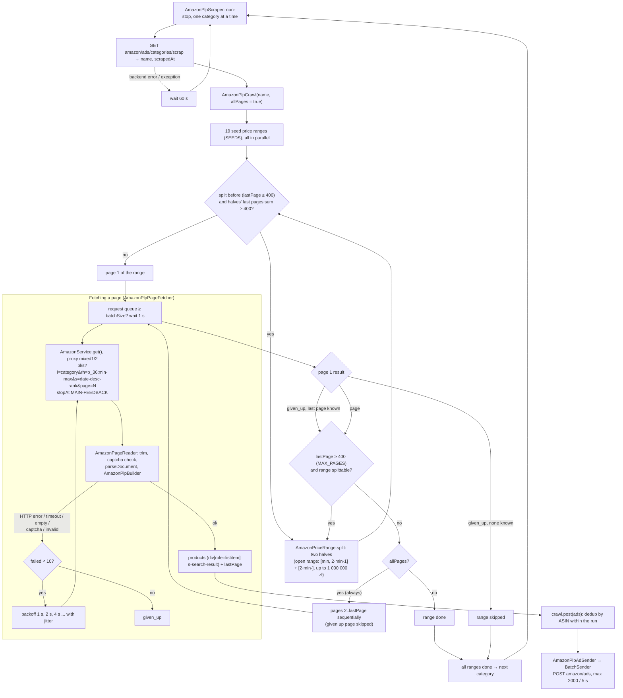

---
paths:
  - "src/marketplaces/amazon/plp/**"
  - "src/marketplaces/amazon/AmazonService.ts"
  - "src/shared/http/**"
  - "src/shared/backend/**"
  - "tests/unit/marketplaces/amazon/plp/**"
---

# Amazon PLP – flow

Goal: find new ASINs in a category on amazon.pl (search listing; new releases is disabled) and send them to the backend. Country `pl` only.

**A PLP logic change (`src/marketplaces/amazon/plp/`, `AmazonService`, shared HTTP/backend) updates this file in the same commit.**

## Diagram

## 1. Process start

1. `npm start -- -t plp`.
2. Same as PDP: config from the backend (`concurrency`, `rps`, `batchSize`), metrics, proxies.
3. `AmazonPlpScraper.execute()`.

## 2. Category loop (`AmazonPlpScraper`)

1. Runs non-stop, one category at a time.
2. `amazon/ads/categories/scrap` → category (`name`, `scrapedAt`).
3. `AmazonPlpCategoryScraper.execute(category)`.
4. Error (backend / exception) → waits 60 s, tries again.

## 3. One category (`AmazonPlpCategoryScraper`)

1. Creates `AmazonPlpCrawl(name, allPages = true)`: all pages of each price range on every scrape; `scrapedAt` is not used.
2. Listing only (`AmazonPlpPageScraper`). New releases (section 4) is disabled: `AmazonNewReleasesScraper` stays in the code but is not called.
3. `crawl.post(ads)` – dedup by ASIN within the run, each ASIN sent once.

## 4. New releases (`AmazonNewReleasesScraper`, disabled)

1. Start: `pl/gp/new-releases/<category>`.
2. From each page:
   - products: `#gridItemRoot [data-asin]` (ASIN, `img`, name from `p13n-sc-css-line-clamp`);
   - subcategories: links `/gp/new-releases/<category>/<nodeId>`;
   - page 2: a `pg=2` link exists → fetches `?pg=2`.
   - download stops at the `</ul>` closing `a-pagination` (after the grid).
3. Recurses into every new subcategory (set of visited nodes), in parallel.
4. Valid = `[class*='zg-browse-group']` present.
5. Metrics: `new_releases_pages`, `new_releases_ads` (new ASINs).

## 5. Search listing (`AmazonPlpPageScraper`)

1. 19 seed price ranges (`SEEDS`, in grosze): `-999`, `1000-1999`, ... `500000-`.
2. All ranges in parallel.
3. URL: `pl/s?i=<category>&rh=p_36%3A<min>-<max>&s=date-desc-rank[&page=N]` (newest first). Referer: random `pl/b?node=...`.
4. Page 1 of a range:
   - last page ≥ 400 (`MAX_PAGES`, Amazon's limit) → range split in half (`AmazonPriceRange.split`), recursion on both halves;
   - an open range (`500000-`) splits into `[min, 2·min-1]` and `[2·min-]`, up to 1 000 000 zł;
   - a single-value range is not split.
   - the last page of every range (per category) is kept in memory between runs; a given up page 1 uses the last known value to split or paginate, none known → range skipped.
   - a range split in an earlier run goes straight to its halves without its own page 1 (its newest products are on the halves' first pages) while the halves' known last pages sum to ≥ 400 (an unknown half counts as 400); once they sum to less, page 1 of the range is fetched again and decides anew.
5. `allPages` → pages 2..lastPage sequentially; a given up page is skipped, the range goes on.
6. Parsing (`AmazonPlpBuilder`):
   - products: `div[role='listitem'][data-component-type='s-search-result']` (ASIN `data-asin`, `img`, name `a > h2 > span`);
   - lastPage: max of `.s-pagination-item`;
   - valid = `s-search-results` present **and** (products present **or** "no results" message);
   - "no results in the category" redirect to all departments (`correction-messages-aps-redirect`) → valid and empty, its products belong to other categories;
   - download stops at `MAIN-FEEDBACK` after the pagination (no pagination → whole page).
7. Metrics: `items`, `item_attempts` (`data` / `no_data` / `given_up`).

## 6. Fetching a page (`AmazonPlpPageFetcher`, shared by 4 and 5)

1. Backpressure: request queue ≥ `batchSize` → waits 1 s at a time.
2. Request via `AmazonService.get()` with proxy type `mixed1/2` (direct 1 min, proxy 2 min) with the builder's `stopAt` markers: the stream is destroyed once they arrived in order.
3. `AmazonPageReader` (shared with PDP) turns the response into a page. Retries up to 10 attempts (`PLP_MAX_FAILED_ATTEMPTS`; PDP and backend keep 6, `MAX_FAILED_ATTEMPTS`), backoff 1 s, 2 s, 4 s ... with jitter, on:
   - HTTP error / network / timeout (403 and 429 count toward blocking the direct family for the host, see PDP 7);
   - empty response (`empty`);
   - captcha (`captcha`, `AmazonCaptchaDetector`, Akamai interstitial included), no block;
   - invalid page or parse exception (`invalid`).
4. Success → `responses{outcome=data|no_data}`.
5. 10 failures → page `given_up`, skipped.

## 7. Sending (`AmazonPlpAdSender`)

1. `BatchSender` on `amazon/ads`, max 2000 ASINs, flush every 5 s or when full.
2. Body: array of `{ asin, name, image, categoryName }`.
3. 5xx / network → retry with the same `Idempotency-Key`; 4xx → dropped.

## Where to look

- 0 products, many `invalid` → selectors in `AmazonPlpBuilder` / `AmazonNewReleasesBuilder` (break silently) + test in `tests/unit/marketplaces/amazon/plp/`.
- ASINs missing in a large category → `MAX_PAGES`, `SEEDS`, `AmazonPriceRange.split`.
- Category takes too long → `allPages` or range splitting.
